# Doctor Tracker Client

Next.js App Router UI for Doctor Tracker. Admins sign in with an httpOnly JWT cookie, manage doctors and patients through searchable/filterable tables, and explore clinic workload on a Recharts dashboard—talking to the Express API through `/api` rewrites.

## Demo credentials

| Field    | Value               |
| -------- | ------------------- |
| Email    | `admin@example.com` |
| Password | `Admin@123`         |

Seed these from the backend (`cd ../backend && npm run seed`).

## Setup Guide

### Prerequisites

- Node.js 20+
- Backend API running (see [`../backend/README.md`](../backend/README.md))

### 1. Install

```bash
cd doctor-tracker-client
npm install
```

### 2. Environment

Copy `.env.example` to `.env.local`:

```env
NEXT_PUBLIC_API_URL=http://localhost:5000
```

`NEXT_PUBLIC_API_URL` is the Express base URL used by Next rewrites for `/api/*`.

### 3. Run

```bash
npm run dev
```

Open [http://localhost:3000](http://localhost:3000) (or the port Next prints if 3000 is busy) and sign in with the demo credentials.

Make sure the API is already running on port `5000` and `CLIENT_URL` in the backend `.env` matches this origin.

### Scripts

| Script          | Purpose             |
| --------------- | ------------------- |
| `npm run dev`   | Next.js app         |
| `npm run build` | Production build    |
| `npm start`     | Serve production    |
| `npm run lint`  | ESLint              |

## System Architecture

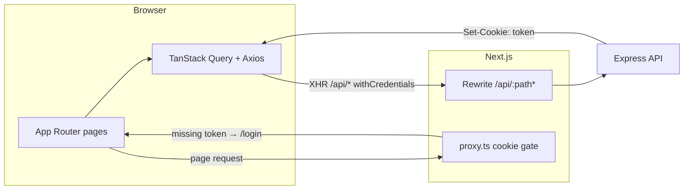

### Auth cookie flow

1. Login posts to `/api/auth/login`; Express sets an httpOnly `token` cookie.
2. Axios sends the cookie on every `/api` call (`withCredentials: true`).
3. `proxy.ts` blocks anonymous page navigations and redirects to `/login`.
4. `GET /api/auth/me` hydrates the session; a 401 interceptor returns the UI to login.

### App routes

| Route | Purpose |
| ----- | ------- |
| `/login` | Auth |
| `/` | Dashboard charts + KPIs |
| `/doctors` | Doctor table (search/filter/page) |
| `/doctors/[id]` | Doctor detail + nested patients |
| `/patients` | Global patient table + edit/delete |

## Technical Decisions

### 1. TanStack Query instead of Redux

Doctor Tracker is mostly **server state**: filtered lists, detail fetches, and dashboard aggregations. The hard problems are caching, refetch-after-mutation, and URL-synced filters—not a large client store.

- Query keys map to resources (`["doctors", params]`, `["dashboard", "stats", range]`).
- `placeholderData: keepPreviousData` keeps tables stable while filters/pages change.
- Mutations invalidate the right slices and toast results without reducer boilerplate.
- Filter state lives in the URL (`useSearchParams`) so it is shareable and refresh-safe.

Local React state is reserved for ephemeral UI (modals, confirm dialogs).

### 2. Reusable UI kit + URL-driven filters

Tables, filters, selects, date pickers, pagination, and page headers are shared components under `components/ui` and `components/features`. That keeps Doctors/Patients screens thin and consistent.

Search is debounced (400ms). Dashboard charts are lazy-loaded with `next/dynamic` so the first paint stays light.

## Visual Evidence

Light and dark themes captured at **1440×900** (desktop) and **390×844** (mobile). Assets live in [`docs/screenshots/`](docs/screenshots/).

### Login

| Light | Dark |
| ----- | ---- |
| 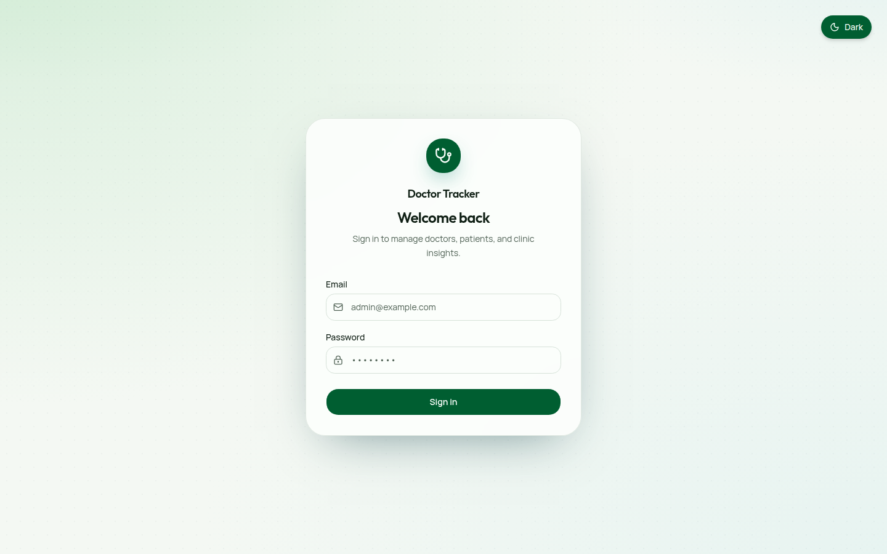 | 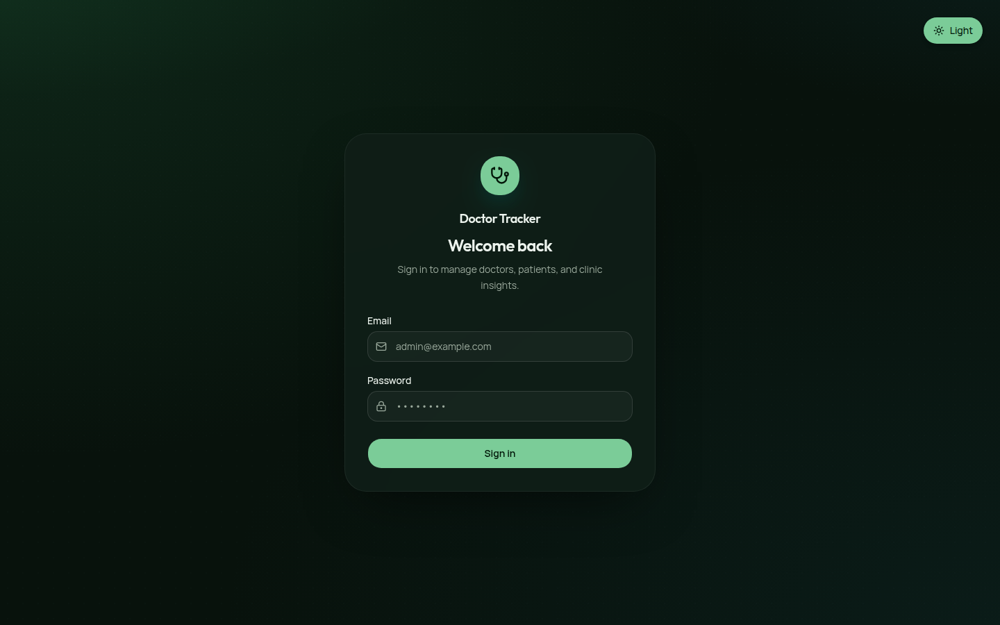 |

*Centered auth card with theme toggle — soft mint surface in light, deep charcoal in dark.*

### Dashboard

| Light | Dark |
| ----- | ---- |
| 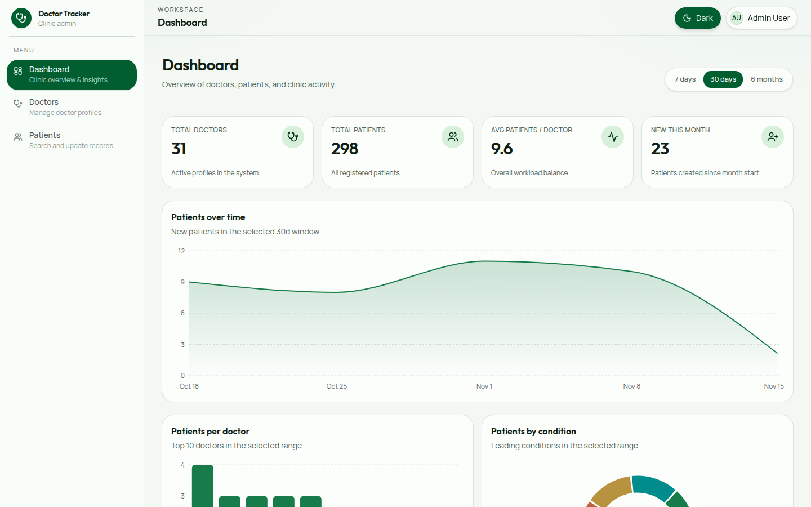 | 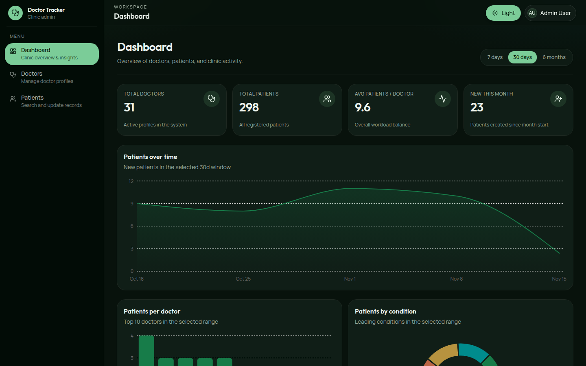 |

*StatCards, range chips, and Recharts (patients over time + breakdowns).*

### Doctors table

| Light | Dark |
| ----- | ---- |
| 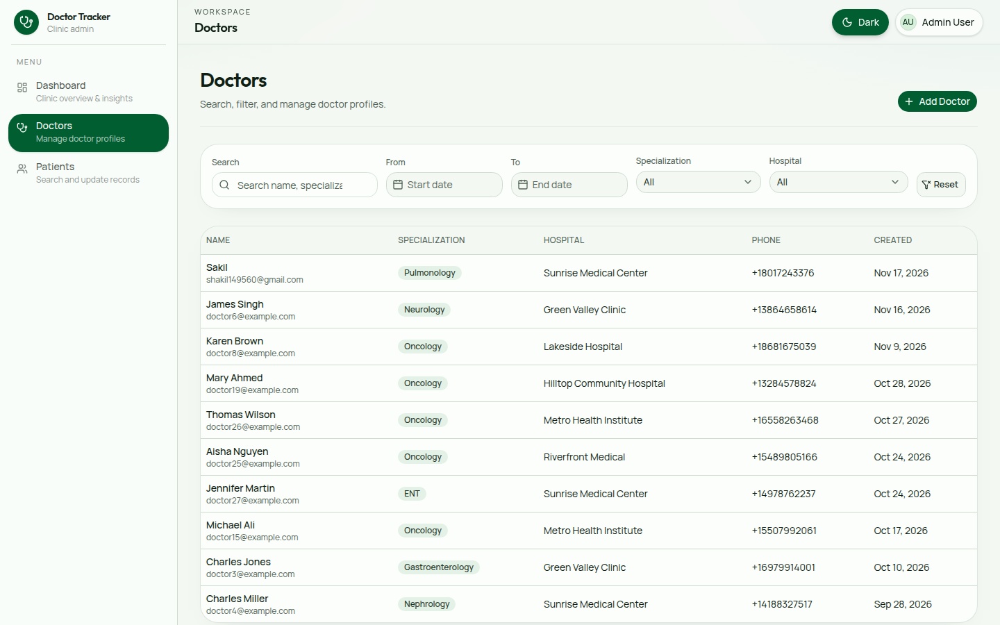 | 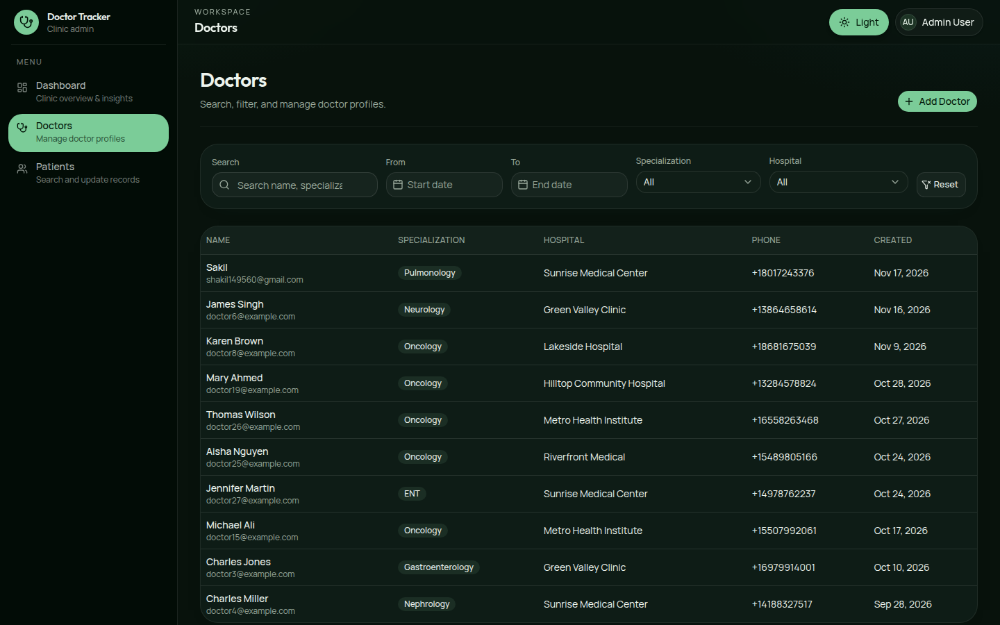 |

*Search, date filters, themed selects, pagination, and Add Doctor.*

### Patients table

| Light | Dark |
| ----- | ---- |
| 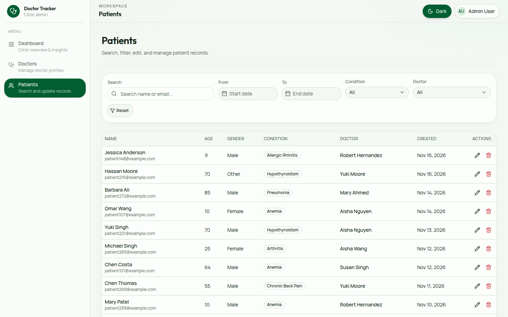 | 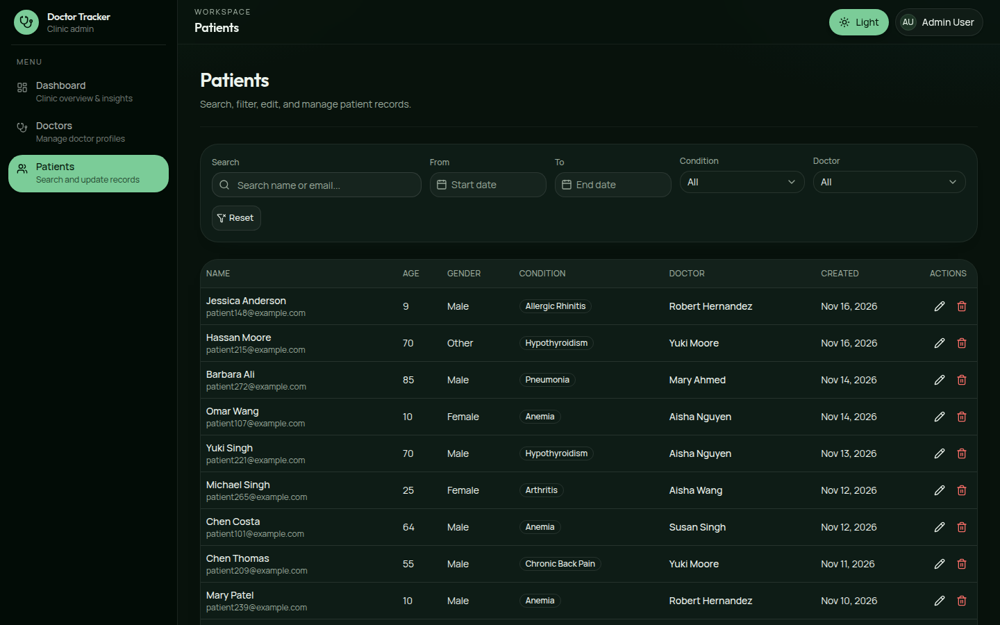 |

*Global patient list with edit/delete actions and URL-synced filters.*

### Mobile

| Light login | Dark login |
| ----------- | ---------- |
| 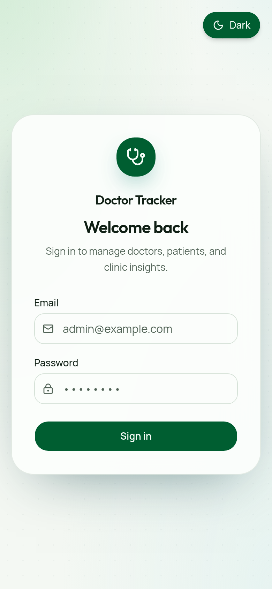 | 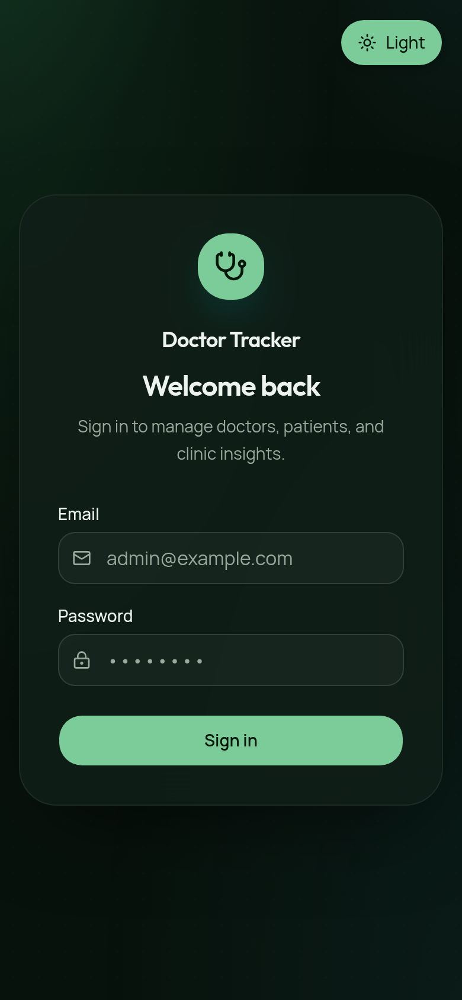 |

| Light dashboard + bottom nav | Dark dashboard + bottom nav |
| ---------------------------- | --------------------------- |
| 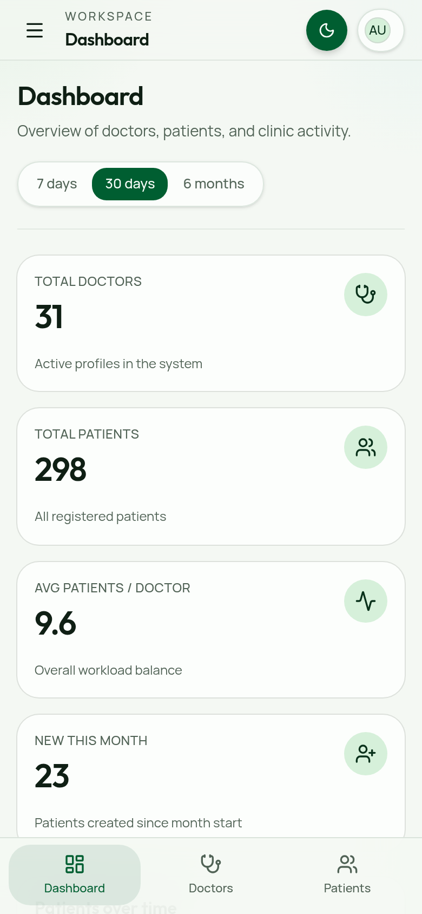 | 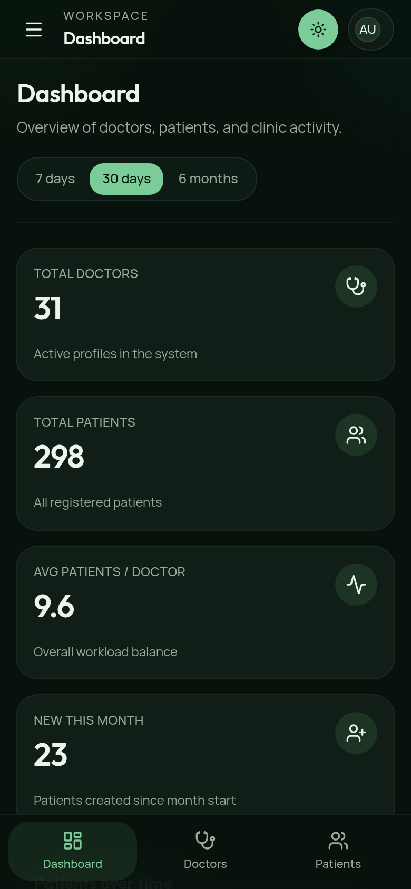 |

```text
docs/screenshots/
  desktop-login-{light,dark}.png
  desktop-dashboard-{light,dark}.png
  desktop-doctors-{light,dark}.png
  desktop-patients-{light,dark}.png
  mobile-login-{light,dark}.png
  mobile-dashboard-{light,dark}.png
  mobile-nav-{light,dark}.png
```

## Project layout

```text
doctor-tracker-client/
├── app/
│   ├── (dashboard)/     dashboard, doctors, patients
│   ├── login/
│   └── globals.css
├── components/
│   ├── ui/              reusable primitives
│   ├── layout/          shell, nav, theme
│   └── features/        domain screens
├── hooks/               Query hooks + URL filters
├── services/            Axios API clients
├── types/
├── docs/screenshots/    light/dark visual evidence
├── .env.example
└── package.json
```
